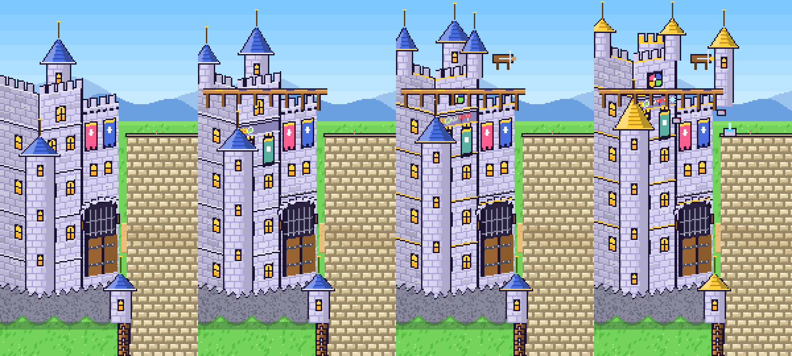

# Siege of Legends

A browser castle-defense auto battler. Draft champions, build items, and hold the castle against ten hordes over 50 sieges, ending with The Eternal Goose.



## Play

Open `index.html` in any modern browser. The whole game is one self-contained file with no server and no installs. `dist/manatorium.html` is the same file.

Saves are kept in the browser's local storage.

## Build

The game is split into plain JavaScript files in `src/` and bundled into one HTML file:

```
node build.mjs        # writes dist/manatorium.html
cp dist/manatorium.html index.html
```

`npm run build` does both steps.

| File | What it holds |
| --- | --- |
| `src/data.js` | Heroes, races, classes, elements, temperaments, horde factions, bosses, items, research, encounters, draft and loot pacing |
| `src/sim.js` | Combat simulation and balance knobs (`BAL`, `HORDE_DIFF`). No DOM, so it runs headless |
| `src/state.js` | Run economy: drafts, loot, research, castle growth |
| `src/sprites.js`, `src/itemart.js` | Procedural 16px pixel art |
| `src/render.js` | Arena canvas, including the castle that grows with every boss |
| `src/fx.js`, `src/spellfx.js` | Effects, sound, and per-hero signature projectiles |
| `src/ui.js`, `src/tips.js` | Drawers, modals, draft screen, tooltips |
| `src/lore.js`, `src/achievements.js`, `src/tower.js` | Story beats, achievements and diamonds, end-of-run tower climb |
| `src/telemetry.js` | Optional playtest logging when hosted as a claude.ai artifact; inert elsewhere |
| `src/main.js`, `src/shell.html`, `src/style.css` | Game flow, input, layout |

## Balance tools

Headless bots play full runs with the real simulation (Node 18+):

```
node tools/boss-odds.mjs <boss 1-10> <runsPerStyle>   # how often each bot style beats boss k
node tools/item-scaling.mjs <runsPerStyle> [styles]  # damage share by class and finished-item count, plus how far bots reach
node tools/tune-horde.mjs '<HORDE_DIFF json>' <startBoss>   # retunes HORDE_DIFF toward the target boss win rates
node tools/sim.mjs [runsPerStyle] [metaRank] [styles]       # older summary runner
```

Current targets: bots with the expected meta upgrades beat each boss about 40% of the time (first boss 45%, final 25%), and a carry with 3 finished items deals about 1.5x the team average.
