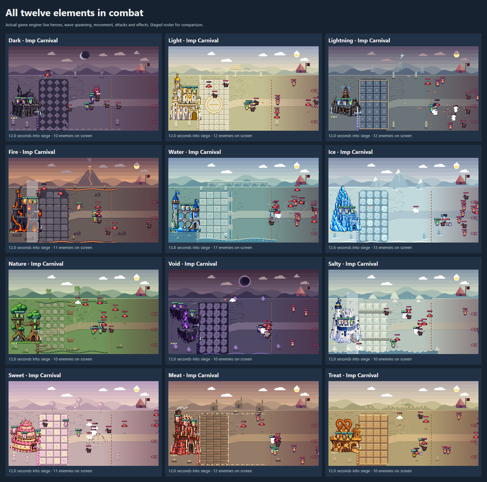
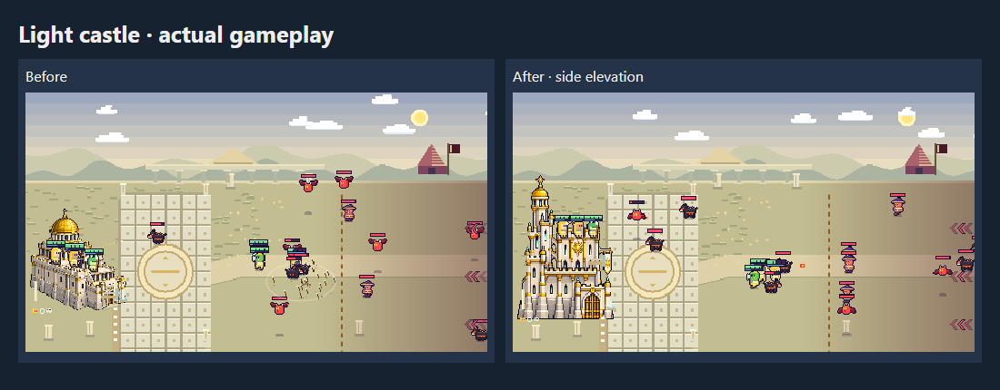
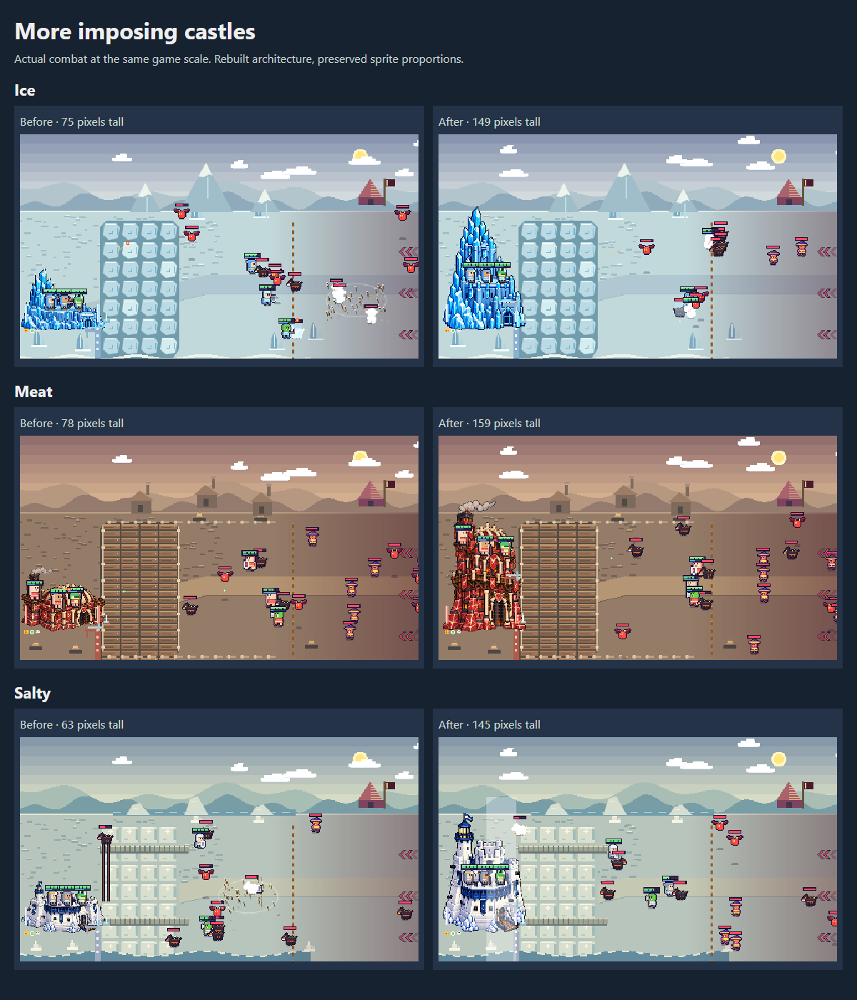

# Elemental castles preview

This work is parked on `feature/elemental-castles-preview` for review and future integration. The repository's default game branch is `claude/project-thread-ytj3kj`; no production deployment is part of this preview.

Download or clone this branch and open [index.html](index.html) in Chrome. It links the standalone playable build, all twelve castles in actual combat, a horde selector, and before/after comparisons. GitHub displays the screenshots below directly; HTML previews require downloading the branch.







## Implementation

- `assets/castles/`: transparent sprites, measured layout metadata, and exact imagegen prompts. Current sprites are Fire/Water/Nature originals; Ice/Meat/Salty/Light v3; remaining elements v2.
- `src/castle-art.js`: decode/cache sprites, uniform scaling, upgrade details and preview cache isolation.
- `src/data.js`: per-element dimensions and defender decks; `src/main.js` and `src/sim.js` use these positions for placement and ladders.
- `src/element-scenes.js`, `src/element-terrain.js`, `src/element-worlds.js`: elemental architecture fallback and surroundings; `src/render.js` combines those surroundings with attacking horde camps.
- `src/style.css`: castle picker previews preserve natural aspect ratios.
- `build.mjs`: embeds sprites and produces `index.html`, `dist/manatorium.html`, and `site/index.html` using a portable Node build.

## Integration later

1. Update this branch with the current default game branch and resolve source changes while preserving newer gameplay rules.
2. Run `node build.mjs` after resolving sources. Rebuild generated HTML files instead of manually merging their embedded scripts.
3. Run the castle checks below, inspect `previews/elemental-castles/index.html`, then merge through a pull request when ready.
4. Deploy only after that review. The checked-in Cloudflare configuration remains the production configuration.

## Validation

Use Node and Playwright with installed Chrome. Set `PLAYWRIGHT_PATH` to your Playwright module directory if it is not installed locally.

```text
node build.mjs
node tools/check-castle-presence.cjs
node tools/check-castle-proportions.cjs
node tools/check-element-scenes.cjs
```

Checks cover all 132 element/growth combinations for uniform proportions, centering, defender positions and ladder access; 1,320 element/horde/growth scenes; distinct architecture/scenery; combat and saved-run reload in desktop and phone-sized Chrome viewports. Gameplay captures use actual wave spawning, movement, attacks and effects with a staged roster.

The standalone build is approximately 24 MB because all twelve PNG sprites are embedded. Review future asset-loading or compression separately if download size becomes a concern.
